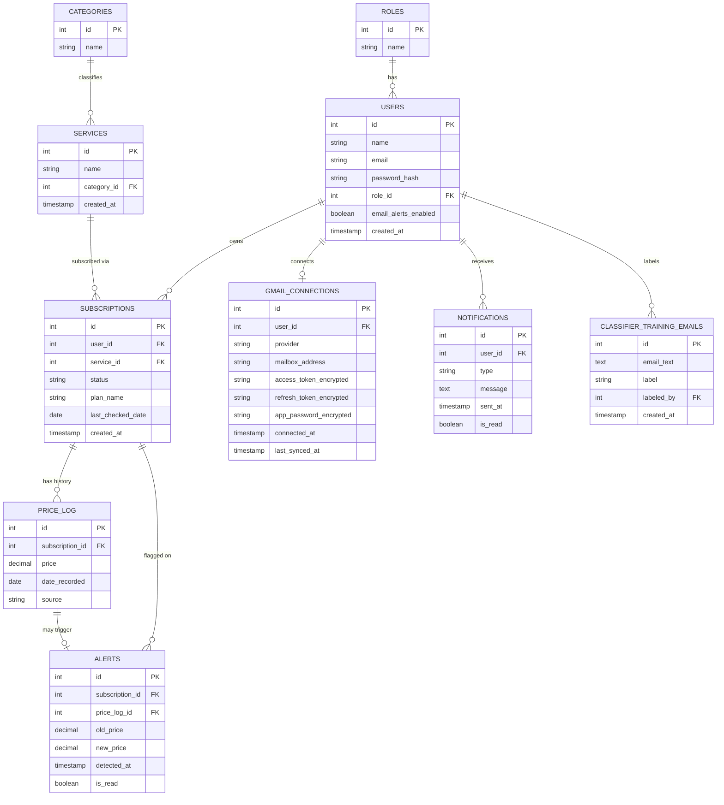

# SubShift — Relational Schema Diagram
*(Derived from the ER Diagram — see `SubShift_ER_Diagram.png`)*

This shows the logical/relational level: every table with its actual columns, primary keys, and foreign keys — the step that comes **after** the conceptual ER diagram, where relationships become FK columns.

Renders automatically on GitHub (Mermaid support is native in `.md` files).

**Primary entities (4+, per rubric):** USERS, SERVICES, SUBSCRIPTIONS, PRICE_LOG
**Relationships (3+, per rubric):** 10 shown above — well over the minimum
**Tables (8+, per rubric):** 10 total

## Notes on cardinality choices
- `USERS ||--o| GMAIL_CONNECTIONS` — one-to-zero-or-one: a user may or may not have connected a mailbox yet. The table keeps its original name but now holds Gmail, Outlook and Yahoo connections (the `provider` column says which)
- `PRICE_LOG ||--o| ALERTS` — zero-or-one: most price_log rows never trigger an alert (only ones where the price changed)
- `ROLES ||--o{ USERS` — one role can apply to many users; this is the RBAC mechanism (single `users` table, role via FK — never separate per-role tables, per the rubric's explicit warning)
- `SERVICES ||--o{ SUBSCRIPTIONS` — a service row is only the brand (for example Claude). The tier (Pro, Plus, Family) is `subscriptions.plan_name`, so different plans of one service are not separate services

## Database programs (see `db/schema.sql`)
- **View:** `active_subscriptions_overview` (joins subscriptions, services, categories and the latest price)
- **Function:** `get_user_spend_summary(user_id)` (spend per category, aggregate query)
- **Stored procedure:** `mark_all_alerts_read(user_id)`
- **Trigger:** `trg_flag_price_hike` on `price_log` (creates an alert when a new price differs from the previous one)
